# Generating Paintings with a DCGAN on WikiArt

ECE 285 homework: train a generative adversarial network (GAN) to generate paintings
from the [WikiArt dataset](https://www.kaggle.com/datasets/steubk/wikiart), and
evaluate the generated images with the Inception Score (IS) and Fréchet Inception
Distance (FID), following the
[PyTorch-Ignite GAN evaluation tutorial](https://pytorch-ignite.ai/blog/gan-evaluation-with-fid-and-is/).

The model is a standard DCGAN ([Radford et al., 2016](https://arxiv.org/abs/1511.06434))
that generates 64×64 images. Starting from a baseline, six runs each change one
factor: learning rates (TTUR), data (Impressionism only), spectral normalisation
in the discriminator, and training length (25 vs. 75 epochs).

**Main finding:** training length matters most. Training for 75 instead of 25 epochs
cuts FID by 63% and raises IS from 2.41 to 2.85, producing recognisable landscapes,
sketches and figures. TTUR and spectral normalisation give no clear benefit.

## Repository contents

| File | Description |
|---|---|
| `wikiart_gan.ipynb` | Full pipeline: data loading, DCGAN, training, loss curves, sample generation, IS/FID evaluation |
| `figures/` | Loss curves and sample grids used in the report |
| `report.pdf` | Report (NeurIPS format) |

## How to run

The notebook is designed for a **Kaggle notebook with a GPU**.

1. Create a Kaggle notebook and upload `wikiart_gan.ipynb` (File → Import Notebook).
2. Attach the dataset: **Add Input → Datasets → search "wikiart" → steubk/wikiart**.
3. Turn on the GPU: **Settings → Accelerator → GPU**.
4. Choose a run by editing the `cfg` dictionary in section 1 (see the table below).
5. For the spectral-norm runs, add this right after `netD.apply(weights_init)` in the
   model cell (initialise first, then apply spectral norm):
   ```python
   for m in netD.modules():
       if isinstance(m, nn.Conv2d):
           nn.utils.spectral_norm(m)
   ```
6. **Save Version → Save & Run All**. Runs take about 15 minutes for 25 epochs and
   about 46 minutes for 75 epochs.

Outside Kaggle, the notebook downloads the dataset with `kagglehub`, which needs
your Kaggle API credentials.

### Run configurations

All runs use seed 42, batch size 128, Adam (β₁ = 0.5, β₂ = 0.999) and real-label
smoothing of 0.9. Unless noted, they use all styles (`style = None`, the same random
30,000 images) and `lr_g = lr_d = 2e-4`. Only the settings below change:

| Run | Change from baseline | `num_epochs` | Spectral norm | `out_dir` | Iterations |
|---|---|---|---|---|---|
| Baseline | — | 25 | No | `outputs` | 5,850 |
| TTUR | `lr_g = 1e-4`, `lr_d = 4e-4` | 25 | No | `outputs_ttur` | 5,850 |
| Impressionism | `style = "Impressionism"` (13,060 images) | 25 | No | `outputs_impressionism` | 2,550 |
| SN | spectral norm in D | 25 | Yes | `outputs_sn` | 5,850 |
| Baseline long | 3× longer training | 75 | No | `outputs_long` | 17,550 |
| SN long | spectral norm + 3× longer | 75 | Yes | `outputs_sn75` | 17,550 |

The last four runs form a 2×2 comparison of spectral normalisation and training length.

## Method

- **Generator:** latent vector z ∈ ℝ¹⁰⁰ → 5 transposed convolutions with BatchNorm and
  ReLU → 3×64×64 image (tanh). 3.58M parameters.
- **Discriminator:** 5 strided convolutions with BatchNorm and LeakyReLU (0.2) → one
  logit. 2.77M parameters.
- **Loss:** non-saturating GAN loss (`BCEWithLogitsLoss`) with one-sided label smoothing.
- **Spectral norm variants:** `nn.utils.spectral_norm` on every discriminator convolution,
  applied after weight initialisation. BatchNorm is kept.
- **Data:** images are resized and centre cropped to 64×64, scaled to [-1, 1] and randomly
  flipped. They are decoded once and cached in memory, because decoding the
  full-resolution JPEGs every epoch was the main bottleneck.
- **Evaluation:** IS and FID from `ignite.metrics`, on 5,000 generated and 5,000 real
  images upsampled to 299×299. The IS of real images at the same resolution is
  reported as a reference. The real images are drawn at random, so their IS varies
  slightly between runs (3.63–3.70); the IS ratio (generated / real) accounts for this.

## Results

| Run | Epochs | IS ↑ | Real IS | IS ratio | FID ↓ (Ignite) |
|---|---|---|---|---|---|
| Baseline | 25 | 2.412 | 3.700 | 0.65 | 0.0709 |
| TTUR | 25 | 2.397 | 3.700 | 0.65 | 0.0701 |
| Impressionism | 25 | 1.680 | 3.135 | 0.54 | 0.0597* |
| SN | 25 | 2.454 | 3.700 | 0.66 | 0.0867 |
| Baseline long | 75 | **2.852** | 3.628 | **0.79** | 0.0264 |
| SN long | 75 | 2.702 | 3.628 | 0.74 | **0.0254** |

\* Computed against Impressionism images, so not comparable with the other rows.

**About the FID values:** Ignite's default FID feature extractor gives values several
orders of magnitude smaller than the reference `pytorch-fid` implementation
([ignite issue #2423](https://github.com/pytorch/ignite/issues/2423)). These FIDs can
be compared with each other, but not with FID numbers published in papers.

**Summary:**
- **Training length is the dominant factor.** 75 epochs instead of 25 cuts FID from
  0.071 to 0.026 (−63%) and raises IS from 65% to 79% of the real-image IS.
- **Spectral normalisation gives no consistent benefit.** At 25 epochs it raises IS by
  0.04 but worsens FID. At 75 epochs it matches the long baseline's FID but lowers IS.
  Keeping BatchNorm alongside it may limit its effect.
- **TTUR makes the discriminator stronger** (mean D(x) ≈ 0.80 vs. 0.72) but has no
  measurable effect on IS or FID.
- **Impressionism only** gives the most stylistically coherent samples (green
  landscapes, pale skies) but less variety, and visible checkerboard artifacts.
- All runs train stably with no mode collapse. A repeat of the baseline gave IS 2.410,
  so IS is reproducible to about ±0.01.

### Samples

| Real (all styles) | Baseline (25 ep.) | Baseline long (75 ep.) | SN long (75 ep.) |
|---|---|---|---|
| 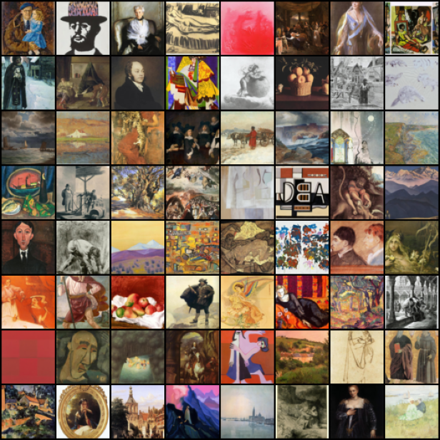 | 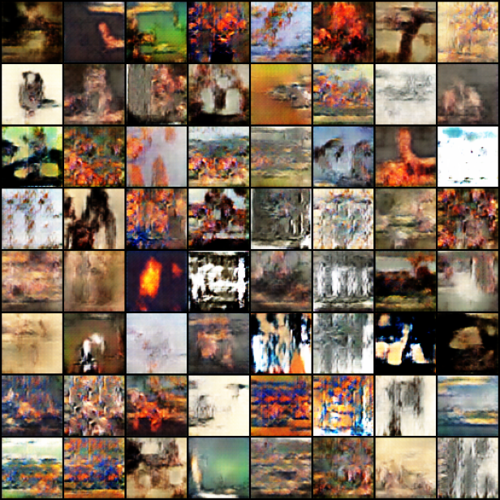 | 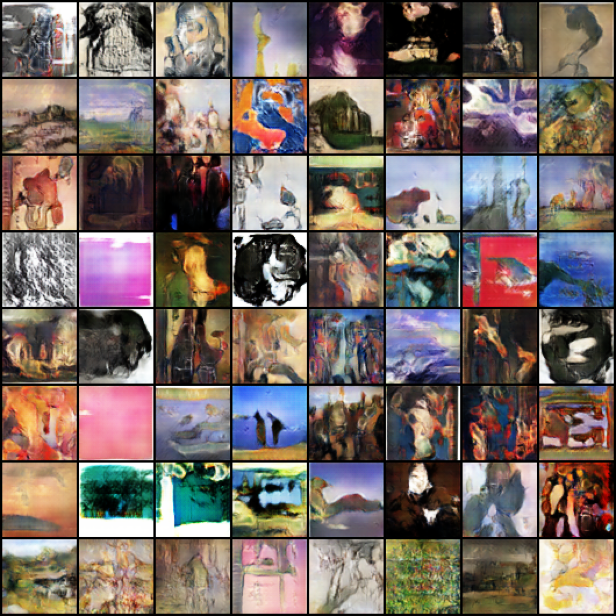 | 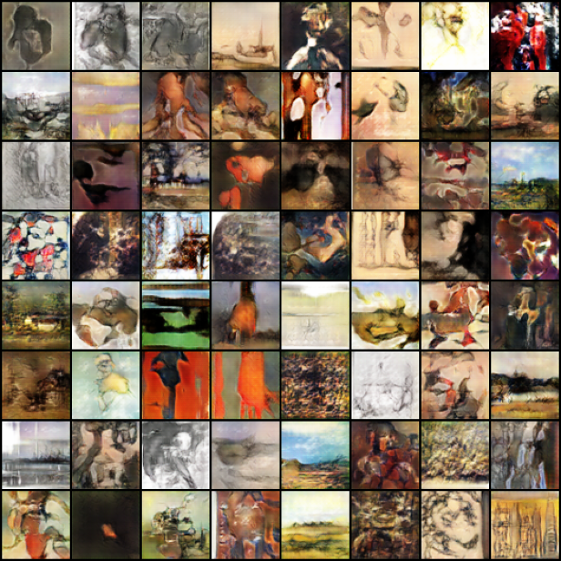 |

| SN (25 ep.) | TTUR (25 ep.) | Impressionism (25 ep.) |
|---|---|---|
| 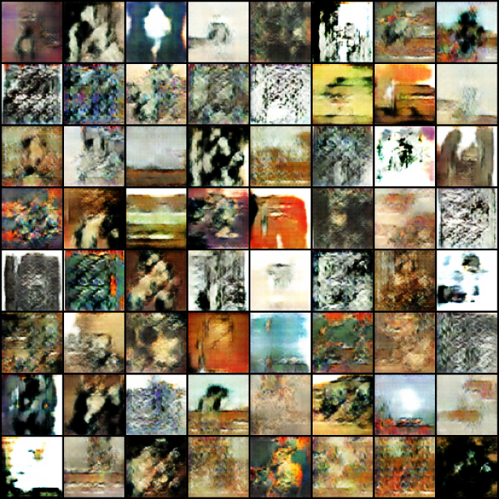 | 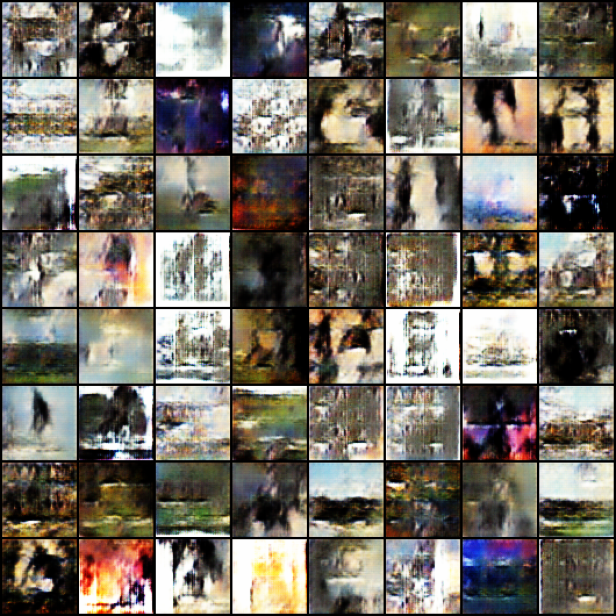 | 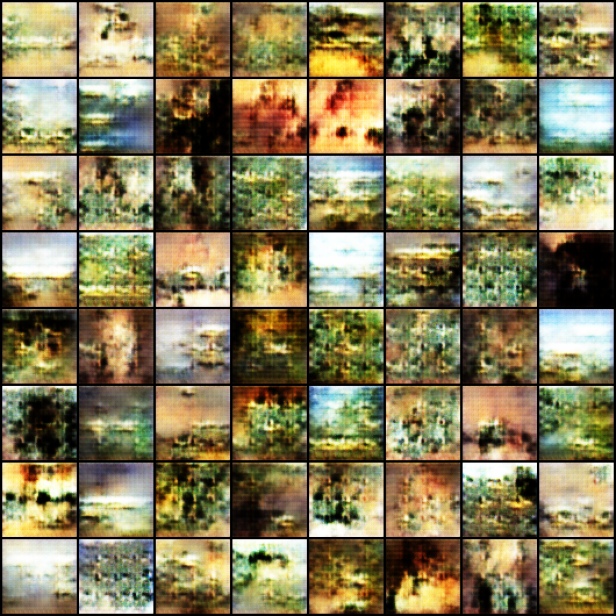 |

**Progress during the long baseline run** (fixed latent batch, epochs 1, 38 and 75):

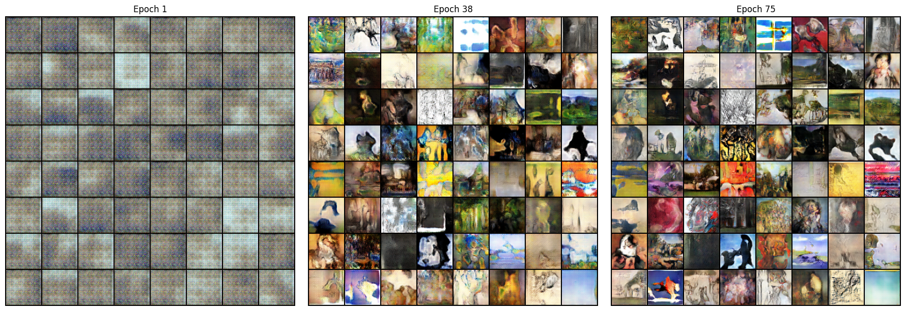

### Loss curves

| Baseline | TTUR | Impressionism |
|---|---|---|
| 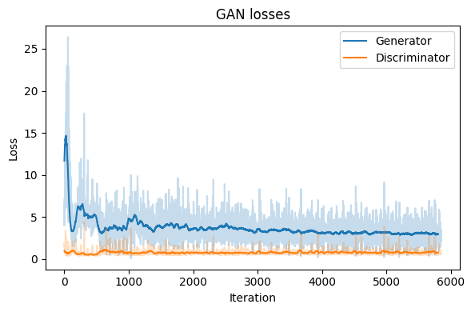 | 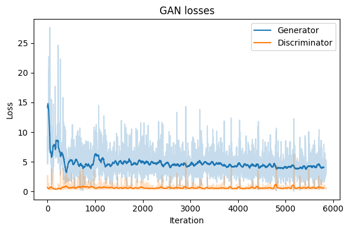 | 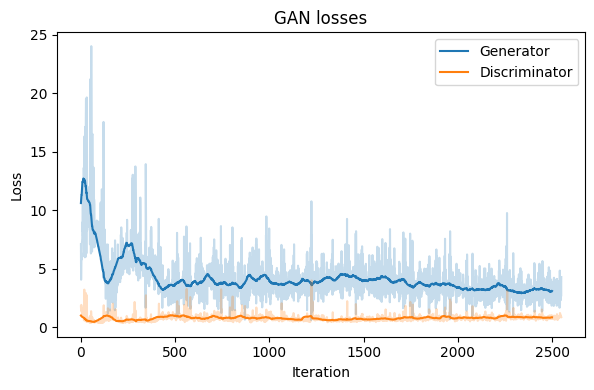 |

| SN | Baseline long | SN long |
|---|---|---|
| 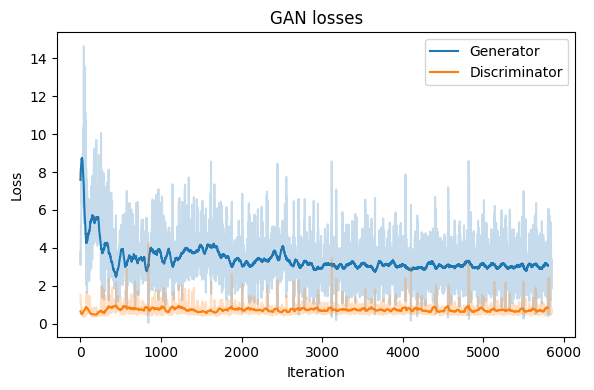 | 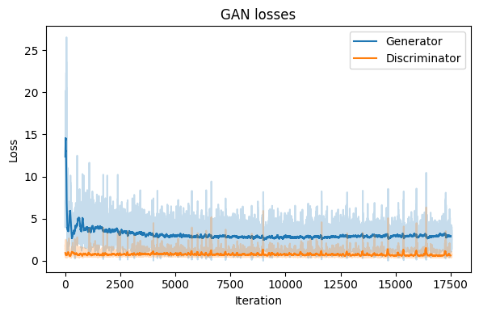 | 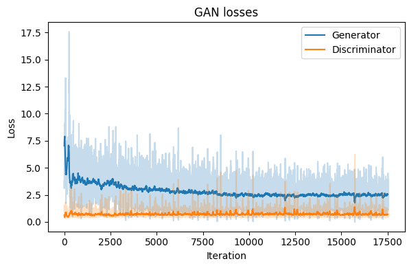 |

## Requirements

`torch`, `torchvision`, `pytorch-ignite`, `scipy`, `numpy`, `matplotlib`, `Pillow`
(and `kagglehub` outside Kaggle). Everything except `pytorch-ignite` is preinstalled
